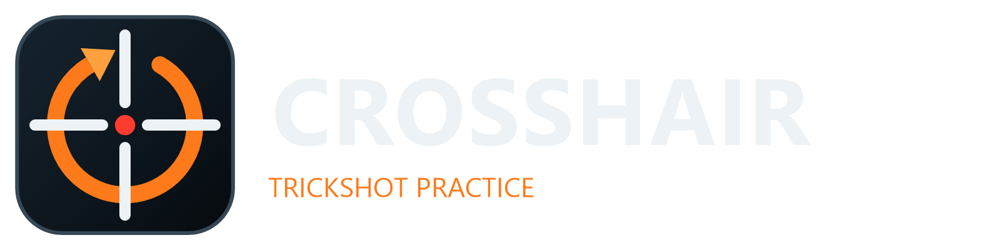

# Crosshair



Crosshair is a first-person shooter built in **Unreal Engine 5.8** that recreates the feel of classic Call of Duty **trickshotting**: jumping, spinning and landing sniper shots in mid-air on the maps people remember. It has a dedicated trickshot practice mode, offline Free-for-all, Team Deathmatch and Kill Confirmed against bots, and the start of same-network multiplayer.

## Class project

This project was made for an **AI-Assisted Software Engineering** course. It was developed with AI coding assistants (OpenAI Codex, then Claude Code) working from written requirements, with every request and its outcome recorded in the course's [AI interaction log](docs/ai-interaction-log.md). The working rules the assistants follow (plan first, build and test locally, document everything, no paid or external services) are in [AGENTS.md](AGENTS.md).

## What it can do

### Trickshot practice
- First-person movement tuned for trickshots: sprint, jump, crouch, mantling onto ledges and through windows, jump buffering and coyote time.
- Bolt-action sniper (with scope), assault rifle and SMG; aim-down-sights, recoil and reloads; frag grenades (with cooking) and throwing tomahawks.
- Head/body hit detection on posed soldier targets, hit markers, headshot feedback, **wallbangs** through thin cover and shootable, climb-through windows.
- Place, rotate and remove practice targets; save your position and instantly reset to repeat an attempt.
- Every successful hit is recorded and can be watched back in the **Replays** menu.

### Offline matches against bots
- **Free-for-all**, **Team Deathmatch** and **Kill Confirmed** on Nuketown, Grid and the new Space Station (the testing map stays practice-only), with Call of Duty default settings: 8-player FFA to 30 kills, 6v6 TDM to 75, 6v6 Kill Confirmed to 65, 10 minutes.
- Black Ops style weapon damage in matches (100 health): the sniper kills in one shot to the head or torso; the AR takes 3 shots up close and 4 at range; the SMG takes 3 shots up close and 5 at range and never kills in one shot. See [weapon damage](docs/offline-match-and-lan.md#weapon-damage-in-matches-2026-10-26).
- **Kill Confirmed**: every kill drops a dog tag. Grab an enemy's tag to score for your team, or grab a teammate's tag to deny the enemy the point. Bots collect tags too.
- Bots with four difficulty presets (Easy, Regular, Hardened, Veteran) that change reaction time, aim error, turn speed and movement. Bots need line of sight, shoot each other and you, and roam the map on navigation meshes.
- COD-style spawns (teams start on opposite sides; respawns avoid enemy sight lines), regenerating health, kill feed, scoreboard and end-of-match results.
- **Every kill you make is saved to Replays**, labelled with how it happened (for example "Mid-air 360 No-scope Headshot - Bolt-Action Sniper, 42 m"), and real trickshots flash a TRICKSHOT banner.

### LAN multiplayer (early preview)
- Host, find and join matches on the same local network using Unreal's built-in local session system (no internet or online service). Joined players fight fully: their shots, reloads, weapon switches and lethals run on the host, which decides hits and damage, and each player keeps their own weapon class.
- A LAN setup screen: your username, game mode, map, bots on or off, bot difficulty and count, score and time limits, and max players. Everyone appears under their own username.
- A **LAN lobby**: hosted matches wait until everyone has joined. The lobby lists every player, lets each player choose Alpha or Bravo in Team Deathmatch and Kill Confirmed, and only the host can start the match.

### Everything else
- Main menu and pause menu designed for mouse, keyboard and controller, with custom weapon classes and weapon camos (including Red Tiger and Arctic).
- Controller support with adjustable sensitivity, dead zone, inversion and a direction calibration.
- Import your own maps as OBJ files or `map.json` packages.
- Realistic lighting (sun, sky, volumetric clouds and fog, film-style grade) applied automatically to every map, including imported ones, plus muscular soldiers with fitted helmets, armor and camouflage.
- Each map has its own sky: a clear midday on the Testing map, a dusty desert late afternoon on Nuketown and a cool broken-cloud morning on Grid.
- A Graphics menu with presets for laptops from integrated graphics up to gaming laptops and desktops, resolution scale, auto-detect and a ray tracing on/off switch.
- **Space Station**: a copy of Nuketown re-themed as an orbital station with a starfield, a planet in the sky, metal decks, white hull panels and solar arrays.
- A startup step that preloads maps, weapons and shaders before play.

## What it is based on

- **Unreal Engine 5.8** and its **First Person C++ template**, including the Unreal mannequin and animations. The trickshot gameplay, matches, bots, menus and replays are custom C++ in `Source/Project_Crosshair/Trickshot`.
- **Call of Duty: Black Ops trickshotting** as the inspiration for movement, weapons, maps and match rules. Crosshair is a student fan project and is not affiliated with or endorsed by Activision or Treyarch; no assets were taken from Call of Duty games.
- **Nuketown**: environment by Alexey Shishnin ([ArtStation listing](https://www.artstation.com/marketplace/p/l0MN8/nuketown-from-black-ops-unreal-engine-5-remake)), which credits ValenQpr's CS:GO remake. See [Nuketown integration](docs/nuketown-import.md). Space Station is a re-themed copy of that environment; see [Space Station](docs/space-station.md).
- **Grid**: "Call of Duty Black Ops 1 Grid Inspired Map" by [PIPO (pipo_)](https://sketchfab.com/pipo_) on [Sketchfab](https://sketchfab.com/3d-models/call-of-duty-black-ops-1-grid-inspired-map-68c0b8b9ffe34a468876044b4c1da00a), licensed [CC BY 4.0](https://creativecommons.org/licenses/by/4.0/) and adapted for this project. See [Grid integration](docs/grid-map.md).
- Weapon models, camos, soldier uniforms and gear were made for this project with the scripts in `Scripts/`. Full credits: [third-party credits](docs/third-party-credits.md).

## Getting started

Requirements: Windows or macOS, **Unreal Engine 5.8**, Visual Studio 2022 with C++ game development tools (Windows) or Xcode (Mac), and **Git LFS** (maps and assets are stored with LFS).

```
git lfs install
git clone git@github.com:BrettRB/Project-Crosshair.git
```

Open `Project_Crosshair.uproject` in Unreal Editor 5.8 (let it build the C++ modules when asked), or build from a terminal:

```
"C:\Program Files\Epic Games\UE_5.8\Engine\Build\BatchFiles\Build.bat" Project_CrosshairEditor Win64 Development -Project="<path>\Project_Crosshair.uproject" -WaitMutex
```

Play in the editor or with **Standalone Game**; replays need Standalone or a packaged build. The game opens on the main menu: choose **Trickshot practice**, **Offline match vs bots** or **LAN match**.

**Mac:** Apple Silicon and macOS 14 or later. Open the project in Unreal Editor 5.8 for Mac, or package an app with `sh Scripts/package_mac.sh`. See [Playing on Mac](docs/mac.md).

## Controls

| Action | Keyboard / mouse | Controller |
| --- | --- | --- |
| Move / look | WASD / mouse | Left stick / right stick |
| Jump / mantle | Space | A |
| Sprint / crouch | Left Shift / C | Left stick click / B |
| Fire / aim | Left / right mouse | RT / LT |
| Reload / switch weapon | R / Q, 1, 2 or mouse wheel | X / Y |
| Lethal (hold to cook, release to throw) / change lethal | G / F | RB / LB |
| Place target / save position / reset (practice) | P / K / T | D-pad Up / Right / Down |
| Scoreboard (matches) | Tab | Back |
| Menu | Esc | Start |

More detail: [gameplay controls](docs/gameplay-controls.md).

## Testing

All builds and tests run locally. Automation tests:

```
UnrealEditor-Cmd "<path>\Project_Crosshair.uproject" -unattended -NullRHI -nosound -ExecCmds="Automation RunTests Crosshair" -TestExit="Automation Test Queue Empty"
```

Gameplay smoke tests run the game with flags such as `-game -CrosshairSmoke` (core practice), `-CrosshairFrontendSmoke`, `-CrosshairLethalSmoke`, `-CrosshairExpansionSmoke` and `-CrosshairMatchSmoke` (offline matches, bots, difficulty, match replays). See the docs below for the exact commands and what each covers.

## Project layout

| Path | Contents |
| --- | --- |
| `Source/Project_Crosshair/Trickshot` | Gameplay C++: character, weapons, lethals, targets, traversal, menus/HUD, replays, matches, bots, LAN sessions |
| `Source/Project_Crosshair/Trickshot/Tests` | Automation and smoke tests |
| `Content/Crosshair` | Maps (practice, Nuketown, Grid, Space Station), player, weapons, soldiers |
| `Scripts` | Unreal Python scripts that create assets, import maps and place spawns |
| `docs` | Design notes, integration records and the AI interaction log |

## Documentation

- [Offline matches and LAN](docs/offline-match-and-lan.md)
- [Gameplay controls](docs/gameplay-controls.md)
- [Traversal, windows and targets](docs/traversal-and-targets.md)
- [Hit feedback and wallbangs](docs/hit-feedback-and-wallbangs.md)
- [Lethal throwables](docs/lethal-throwables.md)
- [Classes, maps and imports](docs/home-classes-and-map-import.md)
- [Weapon appearance](docs/weapon-appearance.md) and [soldier appearances](docs/soldier-appearances.md)
- [Realistic graphics](docs/graphics.md) (including graphics settings and ray tracing)
- [Space Station map](docs/space-station.md)
- Logo and app icon: `docs/branding/`, generated by `Scripts/create_logo.ps1` into `Build/Windows/Application.ico` (the packaged game exe icon) and `Build/Mac/Resources/Assets.xcassets` (the Mac app icon)
- [Startup preparation](docs/startup-preparation.md)
- [Playing on Mac](docs/mac.md)
- [AI interaction log](docs/ai-interaction-log.md)
